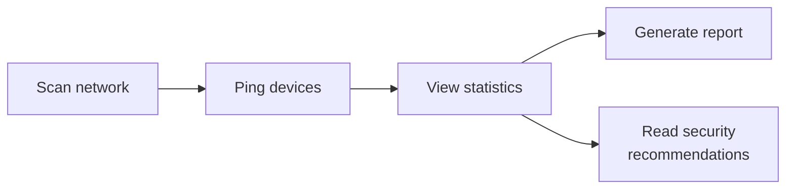

# NetMonitor

**Network Monitoring and Performance Analysis System**: a Windows desktop app that finds the devices on your local network, tests them with ping, tracks latency and packet loss, writes a report, and gives basic security advice.

Final project for CCS 234 (Communications and Networking), West Visayas State University, CICT.


## Features

| | Feature | What it does |
|---|---|---|
| 1 | **Network Discovery** | Detects the local IP, subnet mask, network range and gateway, then lists active devices with IP, hostname and MAC address. |
| 2 | **Connectivity Testing** | Pings one or several devices and shows every reply time, min / average / max, and packet loss. |
| 3 | **Network Statistics** | Per-device average latency, maximum latency, packet loss and jitter from all stored results, with a history chart. |
| 4 | **Report Generator** | Writes a dated HTML or CSV report: devices, ping results, performance summary, recommendations. |
| 5 | **Security Recommendations** | Flags weak connectivity, unreachable hosts, gateway problems and new devices, plus firewall and password reminders. |

Also included: a dashboard with a 0 to 100 network health score, and SQLite storage so history survives a restart.


## Download

Get `NetMonitor-vX.Y.Z-windows.zip` from the [latest release](https://github.com/jstinbrey/network_monitor/releases/latest), unzip it, and run `NetMonitor\NetMonitor.exe`. It needs **Windows 10 or 11** and nothing else: Python is built in.

Windows SmartScreen may warn that the app is unrecognised, because it is not signed: choose *More info*, then *Run anyway*. The history and reports are kept in `%LOCALAPPDATA%\NetMonitor`, so a newer version finds them.

## Run from source

Requires **Windows 10 or 11** and **Python 3.11+**. Administrator rights are not needed.

**Easiest:** double-click `SourceCode\run.bat`. The first run creates a virtual environment and installs the packages, then opens the app.

**Manual**, from PowerShell inside `SourceCode`:

```powershell
python -m venv .venv
.\.venv\Scripts\Activate.ps1
pip install -r requirements.txt
python main.py
```

If PowerShell blocks `Activate.ps1`, run `Set-ExecutionPolicy -Scope CurrentUser RemoteSigned` once.

## Using it



1. **Devices**: click *Scan network* (about 10 to 15 seconds).
2. Select devices and click *Ping selected*, or double-click one device.
3. **Statistics**: click *Refresh all* to ping every known device.
4. **Reports**: click *Generate report*.
5. **Security**: read the recommendations, most severe first.

An administrator can also check a device for open ports from its panel (*Check ports*). Only check devices on a network you own or administer.

## How it works

The app has three layers. The interface never runs network code itself; it calls the services layer in a background thread, so the window stays responsive during a scan.


| Module | Feature | Networking concepts |
|---|---|---|
| `core/netinfo.py` | 1 | IPv4 addressing, subnet mask, CIDR, default gateway, UDP socket |
| `core/discovery.py` | 1 | ICMP ping sweep, ARP table, reverse DNS |
| `core/pinger.py` | 2 | ICMP echo request and reply, round-trip time, packet loss |
| `core/statistics.py` | 3 | Latency, jitter, packet loss |
| `core/report_builder.py` | 4 | Report output (HTML, CSV) |
| `core/advisor.py` | 5 | Connectivity and security rules |

A device that ignores ping but still answers ARP is shown as **No ICMP reply (host up)** instead of offline. This is common for Windows PCs, whose firewall drops ping by default.

## Tests

From `SourceCode`, with the virtual environment active:

```powershell
pytest -v
```

The tests cover address and gateway detection, ping and ARP parsing, statistics, storage, report generation and the recommendation rules. They do not need a network connection.

## Project layout

```
README.txt          plain-text readme required for submission
SourceCode/
  main.py           entry point
  run.bat           one-click install and run
  requirements.txt  pinned package versions
  netmonitor/
    core/           networking logic (one module per feature)
    gui/            window, views and widgets
    services.py     the only module the interface calls
    store.py        SQLite storage
    templates/      HTML report template
  tests/            pytest suite
Documentation/      progress report, diagrams, screenshots
```

## Making a release

Versions are `0.<phase>.<fix>` while the build plan runs, and `1.0.0` is the submitted build. The number lives in one place, `VERSION` in `SourceCode/netmonitor/config.py`, and shows in the title bar.

1. Set `VERSION` (for example `"0.7.0"`), commit, and push.
2. Tag that commit and push the tag:

   ```powershell
   git tag -a v0.7.0 -m "NetMonitor 0.7.0"
   git push origin v0.7.0
   ```

3. GitHub Actions (`.github/workflows/release.yml`) checks that the tag matches `VERSION`, runs the tests, builds `NetMonitor.exe` with PyInstaller, and publishes it on the Releases page (about 5 minutes; progress is on the Actions tab).

A tag with a suffix, such as `v0.7.0-rc.1`, makes a pre-release: use it to try a build before the real one.

## Known limitations

- **Windows only.** The app reads the output of the Windows `ping`, `arp` and `route` commands.
- **IPv4 only**, and a scan covers at most 254 addresses (a /24).
- **Hostnames are not always available.** Many phones show as "Unknown".
- **Some networks hide devices from each other** (school or public Wi-Fi), so a scan there may find only the gateway.
- **Two networks with the same address range share one device list.** To start clean, close the app and delete `SourceCode\data\netmonitor.db`.

Scan only networks that you own or are allowed to test.
