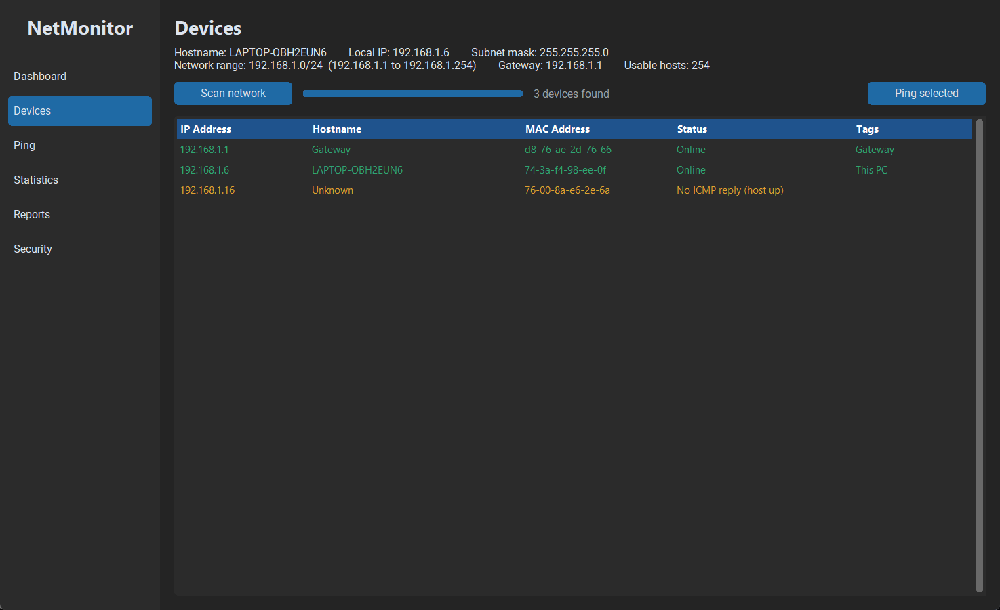
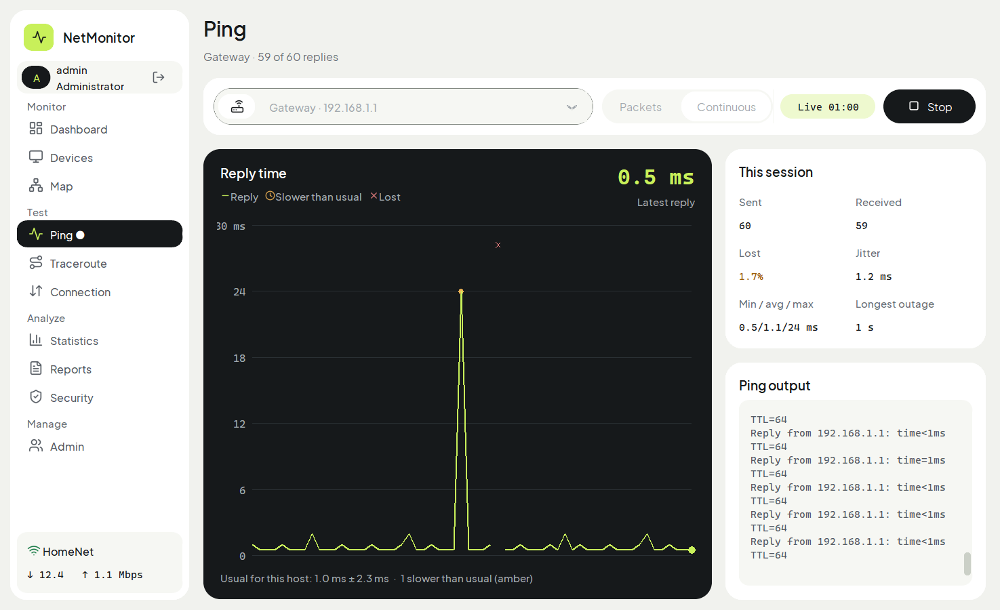
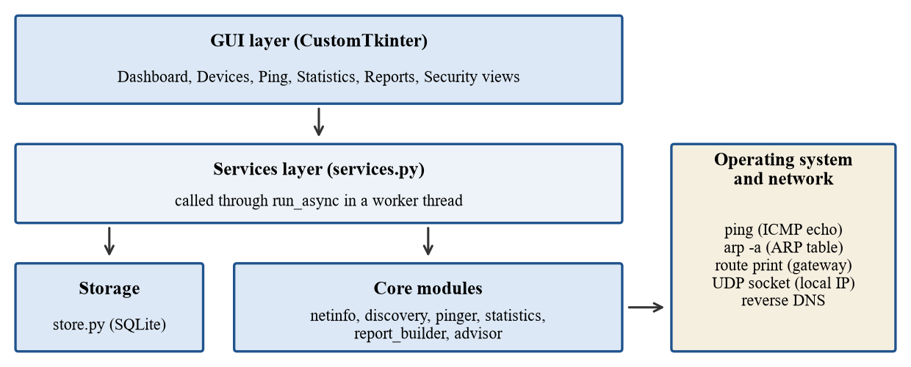

# NetMonitor

NetMonitor is a Windows desktop app for monitoring a local network. It discovers devices, measures latency and packet loss, tracks connection health, and exports reports. **Diagnose network** tests this PC, the router, internet access, and DNS, then explains where a problem starts and what to check next.

Final project for CCS 234 (Communications and Networking), West Visayas State University, CICT.



## Features

| | Feature | What it does |
|---|---|---|
| 1 | **Network Discovery** | Finds devices on the local IPv4 network. Search by name, IP, MAC address or vendor, filter by status, and open a device’s details in the right-hand drawer. **Network details** shows the local IP, subnet mask, address range, and gateway. |
| 2 | **Connectivity Testing** | Ping one device or a batch over IPv4 or IPv6. **Continuous** mode charts reply times live and shows packet loss, jitter, and the longest outage. |
| 3 | **Network Statistics** | See average and maximum latency, packet loss, and jitter across stored results. Select a device to see its history. |
| 4 | **Report Generator** | Save a network snapshot as HTML, CSV, or PDF. Open saved reports from the **Reports** view. |
| 5 | **Security Recommendations** | Review findings such as new devices, risky open ports, weak Wi-Fi security, and possible ARP anomalies. |

- **Dashboard** shows a network health score from 0 to 100 and runs the guided diagnosis.
- **Map** shows device status and logical links to the gateway. It includes IPv6 addresses from Windows’ neighbor cache and groups them with IPv4 addresses when the MAC matches.
- **Traceroute** shows the IPv4 or IPv6 path to a target, with probe times and a verdict on where delay starts.
- **Connection** shows Wi-Fi signal and nearby channels, live upload and download rates, and this PC’s data use for the day.
- **Watch** periodically checks for devices joining or going offline and records uptime samples for known devices.



The screenshots use simulated network data.

## Download

Get `NetMonitor-vX.Y.Z-windows.zip` from the [latest release](https://github.com/jstinbrey/network_monitor/releases/latest), unzip it, and run `NetMonitor\NetMonitor.exe`. The release runs on **Windows 10 or 11** and includes Python.

The release is unsigned, so Windows SmartScreen may show a warning. The app keeps its database and reports in `%LOCALAPPDATA%\NetMonitor`, so a newer release can use the same files.

## Run from source

Use **Windows 10 or 11** and **Python 3.13**, the version used to build the Windows release. You can run the app under a standard Windows account.

Double-click `SourceCode\run.bat` to create a virtual environment, install the packages, and open NetMonitor. Later launches reuse that environment.

For manual setup, run these commands in PowerShell from the project root.

```powershell
cd SourceCode
python -m venv .venv
.\.venv\Scripts\python.exe -m pip install -r requirements.txt
.\.venv\Scripts\python.exe main.py
```

The source build saves its database in `SourceCode/data/netmonitor.db` and generated reports in `SourceCode/output/`.

## Using it

NetMonitor opens as a guest. For your first scan, click **Admin sign in** in the sidebar and create the first administrator account. Use a password of at least eight characters that differs from the username. This account is managed inside NetMonitor.

1. In **Devices**, click **Scan network**. Use the search and status filters to narrow the list.
2. Click a device row to open its details, or select several checkboxes and click **Ping** in the selection bar. The drawer shows recent tests, uptime when available, and actions for **Ping**, **Continuous ping**, and **Traceroute**.
3. In **Dashboard**, click **Diagnose network** to check the connection. In **Statistics**, click **Re-test devices** to ping every listed device and update the stored results.
4. Review findings in **Security**. In **Reports**, select a format, click **Generate report**, then click **Open** when the file is ready.

Use the **IPv4 / IPv6** switch in **Ping** or **Traceroute** to choose an address family. For a manual link-local IPv6 address, include the Windows interface index after `%`, as in `fe80::1%15`. Device picker entries include that index when needed.

| Access | Available actions |
|---|---|
| Guest or signed-in User | View stored devices and history, run ping, traceroute, and diagnosis, and generate reports. |
| Administrator | All of the above, plus scan the network, check ports, rename devices, mark devices as known, and turn on **Watch**. Use **Admin** to manage accounts, set bandwidth limits and the watch interval, or clear the current network’s history. |

If **Connection** asks for Location access, search Windows Settings for **Location** and allow desktop apps to access it to show Wi-Fi details.

## How it works

The Tkinter and CustomTkinter interface calls the services layer. Network operations such as scans and ping run on background threads so the window stays responsive, and SQLite stores the results locally. NetMonitor identifies each network by its IPv4 range and gateway MAC address when available.



| Module | Feature | Networking concepts |
|---|---|---|
| `core/netinfo.py` | 1 | IPv4 addressing, subnet mask, CIDR, default gateway, UDP socket |
| `core/discovery.py` | 1 | ICMP ping sweep, ARP table, reverse DNS |
| `core/pinger.py` | 2 | ICMP echo request and reply, round-trip time, packet loss |
| `core/statistics.py` | 3 | Latency, jitter, packet loss |
| `core/report_builder.py` | 4 | Report output (HTML, CSV, PDF) |
| `core/advisor.py` | 5 | Connectivity and security rules |

**Up, no ping reply** means the device was seen through ARP, but it did not answer ICMP echo requests. Its firewall may block ping.

## Tests

Run the tests from `SourceCode` after setup.

```powershell
.\.venv\Scripts\python.exe -m pytest -v
```

The suite covers address and gateway detection, ping and ARP parsing, statistics, storage, report generation, recommendation rules, and keyboard focus. It uses fixtures for network outputs.

## Project layout

```
README.txt          plain-text readme required for submission
SourceCode/
  main.py           entry point
  run.bat           one-click install and run
  requirements.txt  pinned package versions
  netmonitor/
    core/           networking logic (one module per feature)
    gui/            window, views and widgets
    services.py     operations exposed to the interface
    store.py        SQLite storage
    resources/      theme, fonts, icons and IEEE MAC vendor registry (oui.csv)
    templates/      HTML report template
  tests/            pytest suite
Documentation/      progress report, diagrams, screenshots
```

## Making a release

Versions are `0.<phase>.<fix>` during development, with `1.0.0` reserved for the submitted build. `VERSION` in `SourceCode/netmonitor/config.py` sets the version shown in the title bar.

1. Set `VERSION`, commit, and push.
2. Replace `X.Y.Z` with the configured version, then tag the commit and push the tag.

   ```powershell
   git tag -a vX.Y.Z -m "NetMonitor X.Y.Z"
   git push origin vX.Y.Z
   ```

3. GitHub Actions (`.github/workflows/release.yml`) checks that the tag matches `VERSION`, runs the tests, builds `NetMonitor.exe` with PyInstaller, and publishes the ZIP on the Releases page.

A tag with a suffix such as `-rc.1` publishes a pre-release.

## Known limitations

- **Windows only.** The app uses Windows networking commands. Wi-Fi details depend on English `netsh` output.
- **Discovery starts from an IPv4 LAN.** A scan covers at most 254 IPv4 addresses (a /24). IPv6 discovery uses the active adapter’s neighbor cache, and port checks use IPv4.
- **Hostnames are not always available.** Many phones show as "Unknown".
- **Device discovery is limited by the network.** Wi-Fi client isolation can prevent discovery of other devices.
- **Bandwidth measures this PC’s traffic while NetMonitor is running.** The map shows logical links between devices and the gateway.
- **Accounts gate actions in the app.** Windows file permissions control access to the local database and exported reports.

Scan, check ports, and use Watch only on networks you own or are authorized to administer.
